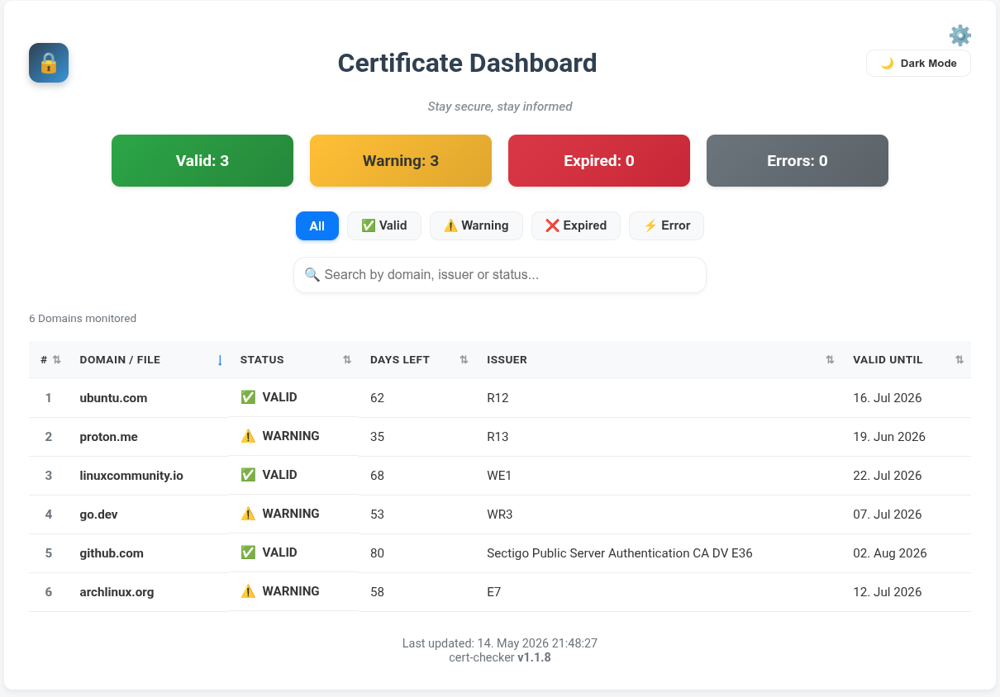
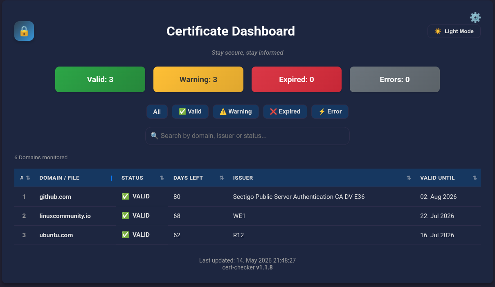

<p align="center">
  
</p>

<p align="center">
  <a href="https://github.com/mrtoadie/go-check-cert/releases"></a>
  <a href="https://github.com/mrtoadie/go-check-cert/releases"></a>
  
  
  
</p>

<h3 align="center">Stay secure, stay informed — monitor SSL/TLS certificates from the terminal or a web dashboard.</h3>

---

**Cert-Checker** is a *privacy-focused* [Go](https://go.dev/) tool that monitors **SSL/TLS certificates** on domains and local files, analyzes expiration dates, and alerts you if any issues are detected.

It offers both a powerful **command-line** interface for automation (CI/CD-ready) and an interactive **web dashboard** for day-to-day monitoring.

## ✨ Features

### 🔍 Certificate Verification
- **Hybrid scanning** — supports remote domains (`https://example.com`) and local certificate files (`.pem`, `.crt`, `.key`)
- **Chain validation** — verifies certificate chains, detects self-signed certificates, and identifies missing intermediates
- **CI/CD ready** — returns specific exit codes (`0` = OK, `1` = Warning, `2` = Error) for pipeline integration

### 📊 Interactive Web Dashboard
- **Real-time visualization** — responsive UI with dark mode support
- **Filtering** — filter by status, search by domain/issuer, sort by expiration date
- **Auto-refresh** — configurable background updates (e.g., every 15 minutes) to keep data fresh

### 🔒 Security & Privacy
- **Local storage** — no external databases or cloud dependencies required
- **HTTPS dashboard** — built-in support for self-signed or Let's Encrypt certificates to secure the dashboard connection

### ⚙️ Automation & Management
- **Cron job manager** — built-in interactive CLI to create, list, and remove scheduled scans
- **Reporting** — exports detailed JSON reports with timestamps for archival or external processing
- **Save certificates** — download valid certificates (optional)

## 🚀 Quick Start

### Build from source

```bash
git clone https://github.com/mrtoadie/go-check-cert.git
cd go-check-cert
go build -o cert-checker
```

### Run directly (without build)

```bash
go run .
```

### Arch Linux

Install from the [AUR](https://aur.archlinux.org/packages/cert-checker):

```bash
yay -S cert-checker
```

### Launch with dashboard

```bash
# Without HTTPS
./cert-checker -web

# With HTTPS and a self-signed certificate
./cert-checker -web -cert ./certs/cert.pem -key ./certs/key.pem
```

Then open `http://localhost:8080` or `https://localhost:8080` in your browser.

<p align="center">
  
</p>
<p align="center">
  
</p>

## ⌨️ Command Line Options

| Flag | Alias | Description |
|------|-------|-------------|
| `-a` | `-advanced` | Show advanced certificate details |
| `-f` | `-file` | Path to a local `.pem`, `.crt`, `.cer`, or `.key` file |
| `-c` | `-cron` | Interactive cron setup |
| `-ls` | `-list` | List and manage cron jobs |
| `-l` | `-log` | Show cron job log file |
| `-dl` | `-download` | Download valid certificates to `certs` folder |
| `-md` | `-markdown` | Save results in Markdown format |
| `-ci` | `-ci-mode` | CI/CD mode (non-interactive, uses `urls.txt`) |
| `-w` | `-web` | Start web dashboard on `localhost:8080` |
| `-cert` | | Path to SSL certificate file (`.pem`/`.crt`) |
| `-key` | | Path to SSL private key file (`.pem`) |
| `-h` | `-help` | Display help message |

## 💡 Examples

Check a single certificate:

```bash
./cert-checker -f ./server.crt
```

Set up cron job(s):

```bash
./cert-checker -c
```

List active cron jobs:

```bash
./cert-checker -ls
```

## ⚙️ Configuration

The tool automatically creates a configuration file on first run.

- **Location:** `~/.config/cert-checker/urls.txt`
- **Format:** one URL per line, comments starting with `#` are supported

Interactive input automatically detects the correct format:

- Press **Enter** to use the default URL list (`~/.config/cert-checker/urls.txt`)
- Check individual URLs: `github.com` or `github.com, ubuntu.com, example.org`
- Check a local certificate file: `~/github.pem` or via flag: `./cert-checker -file ~/github.pem`
- Supported file extensions: `.pem`, `.cer`, `.crt`, `.key`

## 📤 Output Examples

### Text output (default)

```text
=== RESULTS ===

1. forum.linuxguides.de
   Days:  44 | Valid: 26.02.26 → 27.05.26
   Issuer: R12
------------------------------------
2. github.com
   Days:  52 | Valid: 06.03.26 → 03.06.26
   Issuer: Sectigo Public Server Authentication CA DV E36
------------------------------------
=== SUMMARY ===
OK: 0 | Warn: 2 | Exp: 0 | Err: 0
```

### JSON output

```json
{
  "generated_at": "2026-05-03T14:47:42Z",
  "total_count": 1,
  "results": [
    {
      "url": "https://github.com",
      "status": "OK",
      "days_remaining": 180,
      "is_chain_complete": true,
      "key_algorithm": "RSA",
      "key_size": 2048
    }
  ]
}
```

## ⏰ Cron Job Management

Start the interactive menu:

```bash
./cert-checker -cron
```

Menu options:

1. **Set up cron job** — create a new automated check
2. **List & manage jobs** — view/delete existing jobs
3. **Exit** — quit the program

List existing jobs:

```bash
./cert-checker -list
```

```text
=== CERTIFICATE CHECK CRON JOBS ===

1. # cert-checker - 2026-05-03 14:47:42
   0 8 * * * /home/user/cert-checker -ci >> /tmp/cert-check.log 2>&1

2. # cert-checker - 2026-05-03 15:00:00
   0 */6 * * * /home/user/cert-checker -ci >> /tmp/cert-check.log 2>&1

Total: 2 job(s) found.
```

#### Delete individual jobs

1. Run `./cert-checker -list`
2. Select **"Delete individual jobs"**
3. Mark jobs with the **spacebar**
4. Confirm with **Enter**

## ✅ Tested on

| OS | Status |
|---|---|
| [Arch Linux](https://archlinux.org/) | ✅ |
| [Solus](https://getsol.us/) | ✅ |
| WSL2 (Ubuntu) | ✅ |

## 📄 License

go-check-cert is licensed under the [MIT License](LICENSE).
